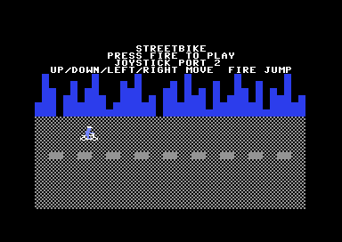
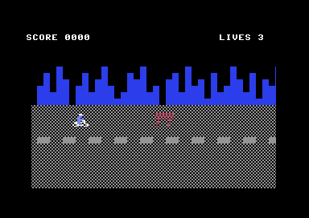

# Streetbike — a C64 game in 6502 assembly

A Commodore 64 sprite game written for the
[ACME](https://sourceforge.net/projects/acme-crossass/) cross-assembler and
tested in **VICE** (`x64sc`).





> **Status:** the side-scrolling bike game is playable: title screen,
> scrolling street, obstacles, jumping, three lives, a crash sequence with a
> get-ready screen, and a game-over screen. Scoring is currently limited to
> the jump-over bonus; survival scoring and the difficulty ramp are Phase 6
> of [`PLAN.md`](PLAN.md).

You ride a bike along a street that scrolls past from right to left. Traffic
cones, trash cans, barriers and potholes come at you in three lanes: steer
around them or jump over them. Jumping over an obstacle scores 25 points;
touching one costs a life. You start with three lives, and when the last one
is gone it is game over.

## Files

| File | Purpose |
|------|---------|
| `src/streetbike.asm` | Full commented source (ACME syntax) |
| `build/streetbike.prg` | Assembled program, ready to load (generated) |
| `build/streetbike.d64` | 1541 disk image containing `streetbike` (generated) |
| `build.ninja` | Ninja build file: assembles with ACME, packs with c1541 |
| `screenshots/` | Screenshots and an animated gameplay GIF, taken in VICE |
| `PLAN.md` | Development plan for the Streetbike refactor |

## Build & run

The build is driven by [Ninja](https://ninja-build.org/). `acme`,
`c1541` (from VICE) and `ninja` must be on your `PATH`.

```sh
ninja
ninja run
ninja clean
```

`ninja` assembles `src/streetbike.asm` directly into `build/streetbike.prg`
with ACME, and then packs that PRG into the disk image
`build/streetbike.d64` with `c1541`;
`ninja run` builds first if needed, then starts the game in VICE and returns
when you close the emulator; `ninja clean` removes the generated build
artifacts.

Or manually:

```sh
acme src/streetbike.asm
c1541 -format "streetbike,sb" d64 build/streetbike.d64 -write build/streetbike.prg streetbike
x64sc -autostart build/streetbike.prg
```

The source's `!to "build/streetbike.prg", cbm` directive selects ACME's CBM
output format, which emits the two-byte PRG load address. The code is
assembled at `$0801`; a `!fill` pads the output to `$2000`, where the sprite
data is assembled with `!pseudopc`, so ACME always writes a ready-to-run
`build/streetbike.prg`.

`build/streetbike.prg` is a normal C64 program you can drop into VICE or run
on real hardware. `build/streetbike.d64` is a standard 1541 image with the
program saved as `streetbike`, ready to attach in VICE (**File → Attach disk
image**) or write to a real floppy.

## Controls

* Joystick in **port 2**
* Up / down = change lane
* Left / right = move along the street
* Fire = jump (and start the game / return to the title screen)

Up and down are ignored while the bike is in the air, and holding fire does
not repeat the jump.

In VICE, joystick port 2 is normally the numeric keypad
(`4` / `6` to move, `0` to fire) or the arrow keys, depending on your
settings. If nothing responds, open **Settings → Joystick** and map
port 2 to the keys you like.

## How it works

The program takes over the machine: it disables the KERNAL interrupt
sources, banks out BASIC and KERNAL, installs its own raster interrupt
handlers and runs its own frame loop.

```
$0400  screen matrix
$07F8  sprite pointers ($80-$86)
$0801  BASIC stub:  10 SYS 2061
$080D  machine code
$2000  bike frame A (player), 64-byte aligned
$2040  bike frame B (player)
$2080  bike jump pose (player)
$20C0  traffic cone
$2100  trash can
$2140  barrier
$2180  pothole
$D800  colour RAM
```

Key pieces of the source:

* **`main_loop`** — waits for raster line 250, reads the joystick, then runs
  the state machine: title (0), playing (1), game over (2), crash (3) and
  get ready (4).
* **`move_player`** — four-way movement, clamped to `PLAYER_MIN_X` …
  `PLAYER_MAX_X` and `PLAYER_MIN_Y` … `PLAYER_MAX_Y`; up and down are
  ignored while airborne.
* **`update_jump`** — fire is edge-detected and starts a 20-frame arc whose
  lift comes from the `jump_lift` table; there is no double jump.
* **`update_scroll` / `scroll_background`** — the street moves left at
  `zp_speed` pixels per frame through the `$D016` fine scroll. When the fine
  scroll wraps, rows 6–24 are shifted one character left and the next world
  column is drawn on the right.
* **`draw_column`** — builds one column of sky, skyline and road; the
  building heights come from `building_heights`.
* **`irq_hud` / `irq_play`** — two chained raster interrupts (lines 50 and
  98) keep the HUD and title rows free of the fine scroll and switch the
  scrolling rows to 38 columns so the street edge does not slide.
* **`spawn_obstacle` / `update_obstacles`** — six obstacle slots, one per
  hardware sprite 1–6. Obstacles enter at x = 320 and scroll left; a new one
  appears every 90 frames in a random lane that is not already receiving
  one.
* **`check_collisions`** — software AABB against the per-type `obs_hit_*`
  insets. The airborne box is narrower than the riding one, so a well-timed
  jump clears an obstacle.
* **`check_bonus`** — awards 25 points once per obstacle when its right edge
  passes the player's left edge while the bike is jumping in that lane.
* **`crash_start` / `update_crash`** — a hit freezes the world for 25
  frames, then throws the bike off the screen along a ballistic arc while
  the sad tune plays, followed by the get-ready or game-over screen.
* **`add_bonus` / `draw_score` / `draw_lives`** — the score is kept as two
  BCD bytes and drawn straight into screen memory; `add_score` is already in
  place for the Phase 6 survival score.
* **`rand_byte`** — an 8-bit LFSR used for obstacle lanes and types.
* **`update_tune`** — the descending SID pulse phrase played during the
  crash sequence.

Sprites live in VIC bank 0 RAM at `$2000`–`$21BF` (pointers `$80`–`$86`),
deliberately outside the `$1000–$1FFF` character-ROM window. The bike is
multicolor (green, white and light blue); the obstacles are hires, one
colour each. The title screen animates the bike in place while the street
scrolls slowly below the text.

## Ideas for extending it

* Survival score and a difficulty ramp (Phase 6): points for distance, a
  faster street and denser obstacles as the score climbs.
* A high score kept in a spare byte and shown on the title screen.
* A low engine tone on SID voice 2 whose frequency follows the scroll speed.
* A short sound effect for the jump.
* A car or another wide obstacle that needs different jump timing.
* A parallax layer or starfield behind the skyline.

Have fun hacking on it — the whole game is one commented file.

## Credits

**Author:** Christoph Scholz <christoph.scholz@gmail.com>

Streetbike was created with intensive use of AI. The code was written in
close collaboration with AI coding agents (Zed's agent, powered by DeepSeek
V4.1 Flash, and Claude Fable 5.1), with the human author directing the
design, reviewing the changes and testing the game.

**Bike animations:** Oliver Stephan <contact@creaturelab3d.com>

* Website: <https://www.creaturelab3d.com/>
* itch.io: <https://o-ossel.itch.io/>

## License

Released under the [MIT License](LICENSE) — see `LICENSE` for the full text.
